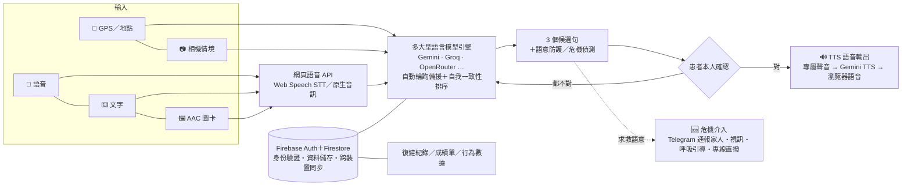

<div align="center">

# 🗣️ 拾語者 Speak My Life（網頁版）

**中風失語者的 AI 溝通與居家復健系統**
*Speak My Life — AI communication & home rehabilitation for stroke survivors with aphasia*

把散落的碎詞拾起，結合環境感知與大型語言模型，重塑成自然、有溫度的語句——
讓「想說卻說不出」的人，即使無法說話，也能被世界聽見。


[🌐 Live Demo](https://timchien918.github.io/Speak-My-Life-Web/) ·
[Android App 原始碼](https://github.com/TimChien918/Speak-My-Life)

</div>

> **關於名稱**：本專案原名 **VoiceWeaver**，現更名為「**拾語者 Speak My Life**」，
> 網址、repo、Google Drive 曲庫資料夾與瀏覽器儲存鍵名都已改成新名，舊資料會自動搬過來——
> 見下方〈[從 VoiceWeaver 更名](#從-voiceweaver-更名)〉。介面上看得到的名字依語言顯示：
> 繁中「拾語者」、英文「Speak My Life」、日韓「Speak My Life（拾語者）」。

---

## 一句話定位

**拾語者是一套「語意重建引擎」**：患者只要給出幾個零碎的詞（打字、說話或點 AAC 圖卡），
系統結合地點與相機情境，讓大型語言模型產生 3 個候選句，**由患者本人確認後**才朗讀出來；
同時提供分級無障礙介面、AI 語音復健與復健軌跡追蹤，以及主動式危機介入。

拾語者有兩個版本，用同一個 Google 帳號登入即可雙向同步 API 金鑰、設定與復健紀錄：

| 版本 | 說明 | 連結 |
| --- | --- | --- |
| **網頁輕量版**（本專案） | 純瀏覽器／API，免安裝，手機、平板、電腦打開就能用 | [Live Demo](https://timchien918.github.io/Speak-My-Life-Web/) |
| **Android App** | 完整功能：離線推理、相機、定位、鼻控、GPT-SoVITS | [原始碼](https://github.com/TimChien918/Speak-My-Life) |

## 從 VoiceWeaver 更名

本專案原名 **VoiceWeaver**。改名不只是換招牌，識別名也一起換了：

| 項目 | 舊 | 新 |
| --- | --- | --- |
| 網頁版網址 | `https://timchien918.github.io/Speak-My-Life-Web/` | **https://timchien918.github.io/Speak-My-Life-Web/** |
| GitHub repo | `TimChien918/VoiceWeaver-Web`、`TimChien918/VoiceWeaver` | `TimChien918/Speak-My-Life-Web`、`TimChien918/Speak-My-Life` |
| Google Drive 曲庫根資料夾 | `VoiceWeaver/` | `Speak-My-Life/` |
| 瀏覽器儲存鍵 | `voiceweaver_web*`、`vw_*` | `sml_web*`、`sml_*` |
| Firebase 專案 ID | `voiceweaver-af4da` | **不變**（見下） |

**自動搬遷（不用動手）**

- **瀏覽器裡的設定與紀錄**：新版第一次開啟時（`js/migrate.js`，比任何讀取都早執行）把舊鍵搬到新鍵——
  語言、金鑰、自訂圖卡、本機歷史與復健紀錄、上次停留的分頁、AAC 排序學習都會沿用；新鍵已有值時以新的為準，
  只做一次（記 `sml_migrated`）。
- **Google Drive 曲庫**：找根資料夾時先找 `Speak-My-Life/`；沒有、但有舊的 `VoiceWeaver/` 時，
  **把舊資料夾改名成 `Speak-My-Life/`**（內容、`catalog.json` 格式都不變）；兩個都有就用新的、不動舊的；
  改名失敗（例如那個資料夾不是本 App 建立的，drive.file 權限改不了）就**直接沿用舊資料夾**——曲庫不會消失。
  手機 App 與電腦端也照同一條規則。
- **雲端同步的資料**（Firestore 裡的設定、歷史、復健紀錄）本來就跟著 Google 帳號走，用同一個帳號登入就全部回來。

**Firebase 專案 ID 為什麼沒改**：Firebase 專案 ID 建立後**永遠不能改名**，所以 `config.js` 的
`authDomain`／`projectId`／`storageBucket` 仍是 `voiceweaver-af4da`。這只是內部識別字，使用者看不到；
Console 上的「顯示名稱」可以自己改成 Speak My Life。

**使用者要做的事**

1. **改用新網址** https://timchien918.github.io/Speak-My-Life-Web/ 並更新書籤／主畫面捷徑。
   GitHub repo 改名後，Pages 的舊網址**不會**自動轉址。
2. **在新網址重新登入一次**（同一個 Google 帳號）。瀏覽器儲存是「依網址」分開的：舊網址存的本機資料，
   新網址讀不到——雲端同步的部分登入就回來；只存在本機、沒登入過的資料（純本機模式）請先在舊網址登入 Google 同步上雲，
   或照常在新網址重新設定。同網址下的舊鍵則會自動搬遷。
3. 第一次在新版打開「設定 → 專屬聲音」時，網頁會試著把 Drive 上的 `VoiceWeaver/` 改名成 `Speak-My-Life/`。
   改名成功後，**還沒更新的舊版 App／電腦端**會找不到 `VoiceWeaver/`——請把各裝置都更新到新版。
4. Colab 的 Secret 名稱改為 `SML_PAIR_CODE`（配對碼本身不變）。
5. 開發者：GitHub 上把兩個 repo 改名，Firebase → Authentication → Authorized domains 確認 `timchien918.github.io` 仍在清單內。

## 設計動機

| 數據 | 意義 |
| --- | --- |
| **9,400 萬** | 全球約 9,400 萬人曾經歷中風，每年約 1,200 萬人新發生（WSO、AHA）[1] |
| **3～5 萬** | 台灣每年新增 3～5 萬名中風患者（衛福部）[2] |
| **約 30%** | 急性期中風患者約三成伴隨失語症（系統性回顧）[3] |
| **從發聲走向語意表達** | 語言復健的需求不只是「發得出音」，而是「把想法組成別人聽得懂的句子」[4][5] |

失語者的困境常常不是「沒有想法」，而是「想法到語言的那條路斷了」。
市面上的 AAC 多半停在「點一張圖卡唸一個詞」，復健 App 多半停在「跟讀一句、給個分數」——
中間那段「把碎詞變成完整、合乎情境的句子」，以及「出事時有人接得住」，正是拾語者要補上的。

## 三種症狀，三種需求

| 症狀 | 表現 | 拾語者怎麼幫 |
| --- | --- | --- |
| **失語症（Aphasia）** | **表達性**：聽得懂卻說不出來，語句斷斷續續或只剩單字；**接受性**：聽覺理解受損，說出的內容混亂；**綜合性**：聽說讀寫皆受影響 | 碎詞 → 完整句的語意重組、候選句確認、AAC 圖卡與情境補位 |
| **言語失用症（Apraxia of Speech）** | 大腦無法正確將發音肌肉的動作排序，發音錯誤或講不出來 | 不必開口也能表達（打字／圖卡／鼻控）；跟讀練習逐字標示錯誤 |
| **吶語症（Dysarthria）** | 控制發音的臉部與口腔肌肉麻痺無力，說話含糊不清 | 由系統代為清楚朗讀（TTS／專屬聲音）；「直接說給 AI 聽」略過易出錯的語音轉文字 |

## 系統架構



（沒有 mermaid 渲染時的文字版）

```text
使用者輸入（語音／文字／AAC＋地點／相機）
        │
        ▼
網頁語音 API（Web Speech STT，或把錄音直接交給支援原生音訊的模型）
        │
        ▼
多大型語言模型引擎（Gemini / Groq / OpenRouter …，輪詢備援＋自我一致性排序）
        │
        ▼
3 個候選句 ──► 患者本人確認 ──► TTS 語音播放（專屬聲音 → Gemini TTS → 瀏覽器）
        │
        └─ 偵測到求救語意 ──► 危機介入（通報家人、視訊、呼吸引導、119/1925）

底層：Firebase 認證 ＋ Firestore 同步層（身份驗證、資料儲存、跨裝置同步）
```

## 五大功能模組

### ① 語意織句引擎 與 情境感知補位

- **解決的痛點**：患者腦中有完整的意思，說出口卻只剩「水……休息……現在」。旁人得一直猜，猜錯了患者也很難糾正；而傳統 AAC 一次只能點出一個詞，組不成句子。
- **操作方式**（入口：**「重組」分頁**）：
  1. 在「碎詞／想說的」輸入幾個詞，或按 **🎤 語音輸入**；講話含糊時可按 **🗣 直接說給 AI 聽**（錄音直接交給支援原生音訊的模型，跳過容易出錯的語音轉文字）。
  2. 需要情境時按 **📍 加入地點**（GPS 反查附近地點）或 **📷 拍照辨識**（相機看懂眼前的東西），情境會一起送進模型。
  3. 按 **✨ 重組成自然句** → 一次攤開 **3 個候選句**（同一組碎詞平行取樣多次，依共識排序取前三）。
  4. **語意確認機制**：點選一句只是「選定」，畫面內嵌出現「**是這個意思嗎？**」，患者按 **對，朗讀** 才會說出口；都不對就按 **都不對？重新生成**。把語言的選擇權還給患者本人。
  5. 選好的句子可再按「更多」複製、分享、收藏成 ⭐ 常用句，或用 🇹🇼／🇺🇸／🇯🇵／🇰🇷 改用其他語言朗讀。

### ② 多模態適應性無障礙介面

- **解決的痛點**：中風常伴隨偏癱、手抖、視力退化；同一個介面不可能同時適合「還能打字」和「只能用眼神或頭部示意」的人。
- **操作方式**（入口：**「設定 → 🧑‍⚕️ 使用模式」**、**「設定 → 偏好」**、**「圖卡」分頁**）：
  - **輕／中／重度三段介面**：輕度以鍵盤打字為主、完整功能；中度超大圖卡預設展開並隱藏複雜設定；重度進入全螢幕「逐張掃描」大圖卡（每 3 秒自動換下一張，看到對的那張點一下就唸），照護者 PIN 才能退出。詳見下方〈三段防呆介面〉。
  - **鼻控追蹤＋停留點選（dwell）**：前鏡頭追鼻尖，轉頭移動游標，停在按鈕上約 1 秒自動點擊，可調靈敏度、一鍵重新置中。
  - **掃描式選擇**：重度模式自動逐張掃描，患者只需在對的時機做一個動作。
  - **高對比與超大字**：純黑底＋高彩文字的高對比模式；字體大小滑桿；圖卡字級 A～A＋＋＋（特大 2 欄／巨大 1 欄自動降級）。
  - **AAC 符號卡**：216 張卡、12 類別，費茲傑羅詞性色碼，依使用頻率／時段／地點自動排序；可用相機拍熟悉的東西做自訂圖卡。
  - **全站觸控防呆**：只認手指放開那一刻、防手抖連點、捲動不算點擊、禁止長按選單。

### ③ AI 語音輔助 與 復健軌跡追蹤

- **解決的痛點**：居家復健沒有治療師在旁，練了也不知道對不對；治療師一週只見一次面，看不到中間的進步或退步。
- **操作方式**（入口：**「復健」分頁**、**「報表」分頁**）：
  - **四級臨床題庫**（名詞 → 動詞 → 短句 → 情境句，**中英日韓**四語、離線可練）：點題目或輸入目標句 → **🎤 開始跟讀**。也可按 **AI 推薦** 依程度出題，或 **📖 整段練習** 自動分句逐句練。
  - **AI 即時回饋**：從語意、**流暢度**、**語調**三面向評分，並把**錯誤的字／詞**高亮標示；無金鑰時退回字元／詞語重疊率計算。
  - **圖片說故事**：四格情境圖卡，用說的講出故事，AI 老師給一句鼓勵與具體下一步建議。
  - **復健軌跡**：「報表」分頁把練習次數、平均分、連續天數畫成**分數趨勢圖**，並彙整**反應時間、選句命中率**、修改次數、圖卡使用比例等行為數據，給語言治療師作為追蹤參考；可匯出 **CSV／PDF** 或 **📤 Telegram** 推送給家人與治療師。

### ④ 語意防護 與 主動式危機介入

- **解決的痛點**：中風後憂鬱很常見，而語言能力受損本身就是獨立風險因子；最需要求救的人，往往最說不出「救命」。
- **操作方式**（入口：**topbar 的 🆘 求救**、**「重組」分頁最上方的快速求救**、以及**自動偵測**）：
  - 系統**主動偵測求救語意**（關鍵字攔截＋AI 判斷是本人求助、代他人求助或無關），不需要患者主動按鈕。
  - 啟動後自動透過 Telegram **通知指定家人**、補傳 **GPS 定位**與現場快照、開啟免登入**視訊通話**房。
  - 等待時提供**呼吸引導**動畫，並可一鍵直撥 **119／1925 安心專線**（號碼依所在國別調整）或家人電話。
  - 需先在 **「設定 → 🆘 緊急通報」** 填入 Telegram Bot Token 與 Chat ID。詳見下方〈危機介入〉。

### ⑤ 擬真聲紋複製 與 情感語音輸出

- **解決的痛點**：機器音讓患者覺得「那不是我在說話」；家人也希望聽見熟悉的聲音。
- **操作方式**（入口：**「設定 → 🗣 我的專屬聲音」**、**「設定 → 🖥 讓電腦幫忙跑運算」**）：
  - 以 **GPT-SoVITS** 用患者病發前的錄音（或家屬的聲音，經本人同意）訓練專屬聲紋，模型存在使用者**自己的 Google Drive**。
  - 合成在使用者自己的電腦或 Colab 免費 GPU 上執行，網頁只送文字過去；**依句子自動偵測情緒，動態切換喜怒哀樂的語氣**。
  - 專屬聲音不可用時自動退回 Gemini TTS，再退回瀏覽器語音，確保「按了朗讀一定有聲音」。

## 六大傑出特性

1. **從發聲走向語意重建**：不只練習發音，更協助患者把零碎詞語組成完整句子。
2. **AI 協助，但由患者決定**：系統提供 3 個候選句與情境提示，最後仍由患者本人確認與選擇。
3. **介面隨能力調整**：依輕、中、重度需求，提供不同圖卡、操作與無障礙方式（鼻控、停留點選、掃描、高對比、超大字）。
4. **跨裝置持續復健**：支援手機、網頁與電腦，Firebase 同步讓居家與醫療端延續使用與紀錄。
5. **復健歷程可追蹤**：將日常練習與表達紀錄轉為趨勢圖與行為數據，作為後續復健參考。
6. **兼顧安全與隱私**：
   - **聲紋需經同意**：專屬聲音只用本人（或經同意的家屬）提供的錄音，模型存在使用者自己的 Google Drive，網頁本身不碰聲紋檔。
   - **錄音評分後刪除**：跟讀評分只把辨識出的文字送去評分；「直接說給 AI 聽」的錄音只存在記憶體、送出判讀後即丟棄，不上傳保存。
   - **危機訊息僅傳送給指定家人**：通報、定位、現場快照與語音訊息只送往使用者自己設定的 Telegram 對象，不經任何第三方伺服器。

## 功能比較

| 功能項目 | Lingraphica | TD Snap | Constant Therapy | **拾語者** |
| --- | :---: | :---: | :---: | :---: |
| AI 碎詞語意重組 | △ | △ | ✕ | ✓ |
| GPS／影像情境補位 | ✕ | ✕ | ✕ | ✓ |
| 重症無障礙操作 | △ | ✓ | △ | ✓ |
| AI 語言復健回饋 | △ | △ | ✓ | ✓ |
| 長期復健追蹤 | △ | △ | ✓ | ✓ |
| 危機介入安全網 | — | — | — | ✓ |

（✓ 支援　△ 部分支援　✕ 不支援　— 無此功能）

## 功能總覽（網頁版現況）

| 分類 | 重點功能 |
| --- | --- |
| **語句重組** | 碎詞 → 自然句，**免金鑰保底供應商（Pollinations）讓它打開就能用**，多供應商自動輪詢備援（Gemini / Groq / OpenRouter / DeepSeek / Mistral / Together / Cohere / OpenAI）、自我一致性排序（同一句話取樣多次，選共識最高的重組結果）、語音輸入（辨識語言跟著介面語言走）、地點／相機情境、直接把錄音餵給支援原生音訊的模型（跳過語音轉文字，避免辨識先出錯） |
| **結果操作** | TTS 朗讀、多語朗讀（🇹🇼中 / 🇺🇸EN / 🇯🇵日 / 🇰🇷한）、一鍵複製、原生分享、加入最愛 |
| **我的最愛** | 常用句快捷卡，點一下即朗讀 |
| **AAC 圖卡** | 216 張卡、12 類別（商品／飲食／金額／動作／需求／人物／地點／醫療／時間／問句／情緒／緊急）、費茲傑羅詞性色碼（黃名詞／綠動詞／藍形容詞）、依使用頻率／時段／地點與詞語共現自動排序（「常用」快捷列＋類別內重排，類別順序本身固定不動）、整句緩衝（點卡進句、按朗讀一次連貫唸）、字級 A~A＋＋＋（特大 2 欄／巨大 1 欄自動降級）、📷 相機拍照自訂圖卡、自訂金額（NTD/USD/JPY/KRW/CNY/EUR） |
| **三段防呆介面** | 輕度（鍵盤打字為主）／中度（超大圖卡預設展開）／重度（去科技化全螢幕逐張掃描大圖卡、照護者 PIN＋**可見按鈕**退出），詳見下方章節 |
| **觸控防呆** | 全站互動只認手指放開那一刻、逐元素防手抖連點、捲動位移超過門檻不算點擊、全面禁止長按觸發選單 |
| **鼻控／頭控** | 前鏡頭追鼻尖移動游標，停留約 1 秒自動點擊（dwell），可調靈敏度與重新置中 |
| **語音復健** | 臨床題庫（名詞／動詞／短句／情境句，離線可練）、AI 全判讀評分（語意／流暢／語氣三面向，非字元差異）、**跟讀辨識與評分跟著介面語言走**（英文介面就練英文，顯示／朗讀／辨識／評分同一語言）、AI 依程度推薦練習句、整段文章自動分句排隊逐句練、錯誤字／詞高亮、streak 連續天數 |
| **看圖說故事** | 3 組四格情境圖卡練習（賣檳榔／身體不適求助／廟口買冷飲），語音輸入講故事、關鍵字命中率算分（同一段話重評不會忽高忽低）、AI 給一句鼓勵＋具體下一步建議 |
| **成績單** | 練習次數、平均分、連續天數、正向情緒統計、趨勢折線圖、行為數據（反應時間／選句命中率／修改次數／圖卡比例）、CSV 匯出（瀏覽器端產生，不經伺服器）、PDF 匯出（開新視窗走瀏覽器列印，中日韓字型渲染正確）、Telegram 推送 |
| **生圖** | Pollinations 意圖圖卡（免金鑰）／電腦或 Colab 的 SD-Turbo／Gemini／HuggingFace／OpenAI |
| **角色語音** | 讓電腦或 Colab 幫忙跑 GPT-SoVITS，依句子自動偵測情緒切換語氣；雲端曲庫瀏覽＋隨選下載 |
| **🆘 危機介入（雙向）** | 關鍵字攔截 → AI 判斷是本人求助還是代替他人求助（避免誤鎖住求救訊息）→ 立即通報家人（Telegram）＋前後鏡頭現場快照＋免登入視訊通話房；**家人可在 Telegram 回覆指令**：`/call` 強制加入視訊、`/camera` 要求再拍現場、`/end` 結束對話；使用者可傳安撫快捷語或錄約 6 秒語音訊息給家人；呼吸引導動畫陪伴等待；1925 安心專線／119／家人電話一鍵直撥；**對話視窗使用者無法自行關閉**，需家人 `/end` 才會結束 |
| **雲端語音** | Gemini TTS（自備金鑰）：比瀏覽器機械音自然得多，電腦沒開也有好聲音；專屬聲音（GPT-SoVITS）永遠優先，兩者都不可用時退回瀏覽器語音 |
| **限時共用金鑰** | 活動期間讓任何人（含匿名）不必自備金鑰就能用；到期由 Firestore 規則強制關閉，每人每天 50 次，用完自動退回免金鑰保底。自己有金鑰的人永遠優先用自己的 |
| **雲端同步** | Firebase Firestore：API 金鑰、設定、最愛、復健日誌（與 Android App 同結構）自動同步 |
| **離線備援** | 無 Firebase 時退回 localStorage，功能完整可用；LLM 全部失敗時句子重組退回規則模板、復健評分退回字元／詞語重疊率計算 |
| **簡轉繁校正** | 部分雲端模型即使提示詞要求繁體，偶爾仍會吐出簡體字；用 OpenCC 字元＋詞組雙層對照校正（round-trip 驗證過，不會誤改本來就正確的繁體字） |
| **四語介面** | 繁中／English／日本語／한국어，介面語言＝朗讀語言＝辨識語言，在「設定 → 偏好 → 語言」一鍵切換 |

## 🧓 三段防呆介面

入口：**「設定 → 🧑‍⚕️ 使用模式（依嚴重程度）」**。

- **🟩 輕度（語法訓練）**：鍵盤打字為主、完整功能。點卡「只進整句緩衝」不即時朗讀，組完按「🔊 朗讀」整句連貫唸出；費茲傑羅色碼＋使用頻率排序引導自然語序。
- **🟨 中度**：超大圖卡預設展開，隱藏複雜設定，介於輕度與重度之間。
- **🟥 重度／高齡防呆**：自動全螢幕，一次只顯示一張特大字識字卡，**每 3 秒自動掃描**換下一張（也可手動「下一張」）；卡片來源優先用照護者拍的照片卡，沒有就用核心生活必需卡。點卡立即輕快朗讀（GPT-SoVITS 走「開心」情緒／瀏覽器 TTS 提高音調）＋提示音＋放大動畫；螢幕常亮（Wake Lock）不熄滅；重新整理會自動回到防呆畫面，長輩不會迷路。
  - **退出方式**：畫面上有一顆明確標示的「✕ 關閉」按鈕，點下去要輸入 4 位 PIN（預設 `1234`，可在使用模式卡裡修改）才能離開——刻意不做成「連點角落隱形區」，因為連照護者自己在真正需要時都不見得能連點準；安全性完全靠 PIN，不靠「不好找」。

## 🆘 危機介入：偵測、通報、雙向對話

與 Android App 行為一致，三層防線：

1. **關鍵字攔截**：偵測到自傷／拒絕治療相關字眼即進入下一步判斷，容忍字元間夾雜空白。
2. **AI 判斷意圖**（而非只看關鍵字）：分類成「本人想自傷」「代替他人求助（例如『我朋友想自殺，快叫救護車』）」「與自傷無關」「無法判斷」。這個分類呼叫刻意不掛「拒絕危險字眼」的防禦提示詞——那會讓模型直接拒答，而分類任務不該被擋。
3. **通報與介入**：
   - 立刻發 Telegram 通知家人（不等定位——定位最慢 6 秒，那 6 秒是家人還不知道出事的時間），定位補在第二則訊息。
   - 靜默擷取前／後鏡頭快照傳給家人；拿不到鏡頭權限就安靜跳過，不擋住通報本身。
   - 給一個免登入免輸名字的視訊通話房連結（Jitsi Meet）。
   - **家人可在 Telegram 直接回覆指令**：`/call`（強制使用者加入視訊，彈窗被瀏覽器擋掉時按鈕會閃爍提示）、`/camera`（要求再拍一次現場）、`/end`（結束對話）；其他文字直接以「家人」對話框顯示給使用者看。
   - 開窗時會把這份指令說明也傳給家人——收到連結卻不知道能做什麼，家人只會乾等。
   - 使用者可傳幾句安撫快捷語或自訂文字，也能錄一段約 6 秒的語音訊息給家人。
   - 呼吸引導動畫（吸 4 秒吐 4 秒）陪伴等待家人回應的過程。
   - 1925 安心專線、119 直撥、改撥家人電話備援（人在國外時號碼依國別調整，按鈕上一定顯示號碼）。
   - **對話視窗使用者無法自行關閉**，只有家人在 Telegram 輸入 `/end` 才會關閉——會走到這個畫面的人，正是最不該讓他一個人把求救關掉的時候。
   - 輪詢一開始會用 `offset=-1` 快轉略過 Telegram 的積壓訊息，避免上一次危機家人打過的 `/end` 被重播、新視窗一開就被誤關。

> **已知限制**：Telegram 的 `getUpdates` 是「誰先拿到誰吃掉」。手機 App 與網頁版若共用同一個 bot token、又同時開著危機視窗，家人的回覆只會被其中一邊收到。

## ☁️ 讓電腦或 Colab 幫忙跑運算

網頁本身不存模型、不做語音合成——語音、生圖、文字都是打「運算端」的 HTTP 橋接（port `9879`）代理過去：

- **同一台電腦**：開網頁的電腦＝跑語音中心（Mac/Win）的電腦 → 免填位址，直接「偵測連線」即可。
- **Colab 免費 GPU**：電腦沒空、或想用免費 GPU 時，執行 `Speak-My-Life_GPT_SoVITS_Colab.ipynb`，複製 ngrok 給的公開網址貼進設定頁，或直接按「☁️ 用此 Colab 網址連線」一鍵套用。
- **遠端電腦**：跑 `tailscale serve --bg 9879`（把橋接埠對外成 HTTPS），設定頁填 `https://主機.xxx.ts.net`。
- ⚠️ 瀏覽器混合內容限制：HTTPS 頁面連不到區網 `http://192.168.x.x`，僅「同機」「Colab（ngrok）」「Tailscale」三種連法可用。

**雲端曲庫**：不論連到電腦還是 Colab，看到的都是同一個 Google Drive 曲庫（`Speak-My-Life/Models/`，舊的 `VoiceWeaver/` 會自動改名過來；`js/localtts.js` 的 `localCatalog()` / `localPrepare()`）——角色清單標示已下載／未下載，未下載的按「下載」請運算端先從 Drive 抓下來，之後合成不用等。

## 快速開始

### 1. 設定 Firebase（5 分鐘，選用）

> 跳過此步驟也能用——僅退回本機儲存，不會雲端同步。

1. 到 [Firebase Console](https://console.firebase.google.com) 建立專案。
2. **Authentication → Sign-in method**：啟用「**Google**」與「**匿名**」。
3. **Firestore Database → 建立資料庫**（正式模式），貼上以下規則：

```
rules_version = '2';
service cloud.firestore {
  match /databases/{db}/documents {
    match /users/{uid}/{document=**} {
      allow read, write: if request.auth != null && request.auth.uid == uid;
    }
  }
}
```

> **完整版在 [`firestore.rules`](firestore.rules)。** 上面只是最小的登入同步規則；
> 用到限時活動、單獨發放、開發者控制中心（帳號名冊）、ngrok 配對的話，請把 `firestore.rules` **整份**貼上去
> （或 `firebase deploy --only firestore:rules`）。
> Firestore 是整份取代，貼片段會讓沒貼到的那些功能靜靜地停掉。

4. **專案設定 → 一般 → 你的應用程式 → Web** → 複製 `firebaseConfig`。
5. 把 `config.example.js` 另存為 **`config.js`**，貼上你的 `firebaseConfig`。

### 2. 部署到 GitHub Pages

```bash
git clone https://github.com/TimChien918/Speak-My-Life-Web.git
cd Speak-My-Life-Web
# 填好 config.js 後：
git add config.js && git commit -m "add firebase config"
git push
```

GitHub repo → **Settings → Pages → Source: main / (root) → Save**。

等約 1 分鐘，網址會是 `https://<你的帳號>.github.io/Speak-My-Life-Web/`。

> **Google 登入授權網域**：回 Firebase → Authentication → Settings → Authorized domains，加入 `你的帳號.github.io`。

### 3. AI 能力（打開就有，要更好再自己加金鑰）

**打開就能用**：文字重組與生圖都有一個**免金鑰的保底供應商**（Pollinations），
不必登入、不必設定任何東西就會動。朗讀則永遠有瀏覽器內建語音保底。

**想要更好的品質**：到「**設定 → 💬 文字供應商**」新增 Gemini / Groq / OpenRouter 任一金鑰。
自己的金鑰永遠排在保底之前，保底只在你沒設、或你設的那幾家全部失敗時才會用到。
語音（Gemini TTS）與生圖各有自己的清單，同樣是填一把金鑰。

> **為什麼不能「登入就自動用你帳號的額度」**：試過了，走不通。
> `generativelanguage.googleapis.com`（Gemini API）**不收使用者的 OAuth 權杖**——拿
> Bearer token 打 `generateContent` 一律回 403「Request had insufficient authentication
> scopes」，而且沒有任何範圍解得開，`cloud-platform` 也不行。那個端點就是設計成收 API
> 金鑰的。Google 自己的 Gemini CLI 走的是 `cloudcode-pa.googleapis.com/v1internal`，
> 一個沒有文件、request 格式不同的內部端點。
> **Google AI Studio 做得到「登入就直接用你帳號的額度」，是因為它是 Google 第一方
> 應用程式；第三方網頁沒有這條路。**

### 3.5（選用）限時活動：借站方的金鑰給大家用

活動期間讓**任何人**（含匿名「直接開始」）不必自備金鑰就能用完整 AI。
自己已經填了金鑰的人不受影響——永遠優先用他自己的。

**管理全部在網頁版的「設定 → 🛠 開發者控制中心」**，而且**只有開發者帳號**
（Google 登入的 `timchien918@gmail.com`）看得到、寫得動。開啟／關閉／改期間／換金鑰
都是在那一頁改資料，不必再碰規則。

> ⚠️ **第一次使用前，必須把新版 [`firestore.rules`](firestore.rules) 整份部署上去**，
> 否則控制中心的每一個按鈕都會被拒絕（畫面會提示「被 Firestore 規則拒絕」）：
> - 貼到 **Firebase Console → Firestore Database → 規則 → 發布**；或
> - 在有 `firebase.json` 的資料夾執行 `firebase deploy --only firestore:rules`。
>
> 規則不會跟著 GitHub Pages 自動部署。Firestore 是整份取代，只貼片段會讓沒貼到的功能靜靜停掉。

控制中心有三個區塊：

| 區塊 | 能做什麼 |
| --- | --- |
| 📢 全站活動 | 看 `shared/apiKeys` 現況（狀態、期間、每日次數、各類金鑰數；金鑰只露前 6 後 4）；改啟用、開始日、結束日、每人每日次數、文字／生圖／語音金鑰；「📥 從我的設定匯入金鑰」一鍵帶入自己設定頁的金鑰；「⛔ 立即停用」 |
| 🎁 單獨發放 | 從名冊搜尋帳號（email／名字），設定期間、每日次數、金鑰（可勾「沿用全站那份的金鑰」，儲存當下複製一份）；列出現有發放、收回（改成停用）或刪除 |
| 👥 帳號管理 | 名冊列表（email、名字、最後上線）、每個人今天借用幾次、有沒有單獨發放 |

每個寫入都有二次確認；寫入前會先檢查欄位（結束日不能早於開始日、啟用時至少要有一把金鑰、
每日次數是正整數……），規則那一層也會再驗一次型別。

規則怎麼擋（摘要；要部署的是整份 `firestore.rules`）：

```
function isAdmin() {          // Google 登入、信箱已驗證、在清單內
  return request.auth != null
      && request.auth.token.email_verified == true
      && request.auth.token.firebase.sign_in_provider == 'google.com'
      && request.auth.token.email in ["timchien918@gmail.com"];
}
match /shared/apiKeys {
  // 一般人：登入（含匿名）且在活動期間才讀得到；開發者永遠讀得到（要能看已停用／過期的那份）
  allow get: if isAdmin() || (request.auth != null && resource.data.enabled == true
             && request.time >= resource.data.activeFrom && request.time < resource.data.activeUntil);
  allow list: if false;
  allow create, update: if isAdmin() && validCampaign(request.resource.data);
  allow delete: if isAdmin();
}
```

文件 `shared/apiKeys` 的欄位（控制中心寫入的就是這個形狀，`js/shared.js` 照這個讀）：

| 欄位 | 型別 | 說明 |
| --- | --- | --- |
| `enabled` | boolean | 總開關，關掉就立刻結束 |
| `activeFrom` / `activeUntil` | **timestamp** | 活動起訖（`activeUntil` 存的是最後一天的隔天 00:00，以瀏覽器本地時間解讀，跟活動標記的顯示一致）。**一定要是 timestamp**——規則拿 `request.time` 跟它比，ISO 字串會讓比較永遠不成立，規則也會拒絕寫入字串 |
| `dailyLimit` | number | 每人每日次數，不填就是 50 |
| `llmApis` / `imageApis` / `ttsApis` | array of map | 要借出的金鑰，每筆 `{provider, key, model}`（Cloudflare 另有 `account`），可多把（依 uid 分配一把，失敗自動換下一把） |
| `updatedAt` / `updatedBy` | timestamp / string | 控制中心記錄誰、何時改的（讀取端不用） |

每日次數的計數存在 `users/{uid}/usage/{YYYY-MM-DD}`（UTC 切日）。本人讀寫自己的，
開發者另外可以 get（控制中心顯示用量）。用完會自動退回免金鑰的保底供應商，不會變成不能用。

### 3.6（選用）單獨發活動給某一個人

有時要開的不是全站，而是**只給某個人**——他的用量比較大，或全站活動已經結束
但這個人還需要。這種放在 `grants/{uid}`，同樣在控制中心的「🎁 單獨發放」管理。

```
match /grants/{uid} {
  // 只有本人讀得到，而且一樣要在期間內——期限由規則強制，改前端沒有用。
  allow get: if isAdmin() || (request.auth != null && request.auth.uid == uid
             && resource.data.enabled == true
             && request.time >= resource.data.activeFrom && request.time < resource.data.activeUntil);
  allow list: if isAdmin();
  allow create, update: if isAdmin() && validCampaign(request.resource.data);
  allow delete: if isAdmin();
}
```

**為什麼是獨立的 collection，不是塞進 `users/{uid}`：** users 那條規則是
「本人可讀寫自己的資料」，本人永遠讀得到——期限會形同虛設。放在 `grants` 才能
跟 `shared/apiKeys` 一樣，由 `request.time` 真的擋住。

欄位跟 `shared/apiKeys` 相同（另附 `email`／`name` 方便辨認）。兩份同時生效時
**每日次數相加、金鑰兩邊都能用（個人那份先用）**——單獨發放通常就是要「加碼」，
被全站那份蓋掉的話加碼等於沒發生。

**帳號名冊 `directory/{uid}`：** 瀏覽器沒有 Admin SDK，列不出 Firebase Auth 裡有誰，
所以每個 Google 登入的使用者會在背景登記自己（`email`、`name`、`photo`、`lastSeen`，
一天最多寫一次）。規則只准本人寫自己那份、`email` 必須等於登入憑證裡的信箱、
只能有這幾個欄位；讀取、列出、刪除只有開發者。匿名使用者不登記，
所以要單獨發放給某人，請他先用 Google 登入一次。

**管理工具：本機管理腳本（舊名 `vw_admin.py`）與服務帳戶私鑰不再需要。** 以前活動文件只能由本機的
管理腳本用服務帳戶私鑰寫入（那把私鑰繞過所有規則、等於整個專案的最高權限）；
現在改由開發者用自己的 Google 帳號在網頁上寫，權限由規則的 `isAdmin()` 把關。
舊的私鑰建議到 Google Cloud Console → IAM → 服務帳戶 → 金鑰 刪掉。
（`.gitignore` 裡那幾行保留，避免有人又把私鑰放回 repo。）

**要更換或新增管理員，兩處都要改：**
1. [`js/admin.js`](js/admin.js) 的 `ADMIN_EMAILS`（決定誰看得到控制中心）；
2. [`firestore.rules`](firestore.rules) 的 `isAdmin()` 清單（決定誰寫得動），改完**重新部署規則**。

只改前端只會得到一頁「按了全部被拒絕」的介面；只改規則則看不到入口。

> **這個機制擋得住什麼、擋不住什麼——請務必看懂再開：**
>
> **金鑰一旦送進瀏覽器就等於交出去了。** 使用者可以打開 devtools 複製走，
> 然後直接呼叫 Google，完全繞過每日次數。所以：
> - ✅ **期間與開關是真的擋得住的**：由 Firestore 規則比對文件欄位，改前端沒用。
> - ✅ **誰能改活動是真的擋得住的**：寫入只開給規則裡的開發者信箱（Google 登入且已驗證）。
> - ⚠️ **每日次數是防呆，不是防護**：擋得住一般使用者，擋不住刻意的人；
>   匿名使用者清掉瀏覽器資料就換一個身分重新計數。
> - ⚠️ **活動結束後請把那幾把金鑰換掉**。關掉之後雖然沒有人再借得到，
>   但活動期間流出去的金鑰仍然有效。
>
> 建議另開一把「活動專用」的金鑰（只給 Gemini 用、在 Google Cloud 上設好每日
> 上限），而不是把你平常在用的那幾把放上去。

### 4.（選用）緊急通報

到「設定 → 🆘 緊急通報」填入 Telegram Bot Token 與 Chat ID，才能使用求救／危機介入功能通知家人。

### 5.（選用）連上電腦或 Colab 跑語音

到「設定 → 🖥 讓電腦幫忙跑運算」啟用，同機直接偵測，或依上方「讓電腦或 Colab 幫忙跑運算」章節設定。

## 技術說明

- **語言**：純 ES6 模組（無打包工具），可直接用 GitHub Pages 靜態托管。
- **TTS 三層**：專屬聲音（GPT-SoVITS，要電腦／Colab 開著）→ 雲端 TTS（Gemini）→ 瀏覽器原生 Web Speech API。上面兩層任何一種失敗都自動落到下一層，最底層免金鑰、零延遲，所以「按了朗讀卻沒聲音」不會發生。快速求救那三顆與重症防呆模式刻意直接走瀏覽器語音——那些場合出得了聲比音色重要。Gemini TTS 回的是裸 PCM，`js/providers.js` 補 RIFF 檔頭後才播。
- **STT**：瀏覽器原生 Web Speech API（免金鑰），辨識語言跟著介面語言走。
- **LLM**：多供應商自動輪詢＋失敗換下一家（`js/providers.js`），復健評分會改用固定順序而非輪替，避免同一句話因為換了模型而分數飄動。
- **句子重組**：`js/llm.js` 對同一組碎詞平行取樣多次，每次回傳多個候選句，攤平後依「相同文意出現次數、再看平均信心」排序取前三；JSON 解析容忍截斷與格式錯誤，絕不把解析失敗的原始 JSON 當作一句話唸出來。
- **危機意圖分類**：`classifyCrisisIntent()` 獨立於句子重組之外呼叫，刻意不掛安全防禦提示詞，因為那會讓分類任務被模型拒答。
- **復健評分**：呼叫雲端 LLM 語義判讀，回傳 `{score, feedback, wrongChars}`；提示詞要求輸出語言跟著介面語言走；無金鑰或呼叫失敗時退回重疊率計算（中文按字、拉丁語言按詞）。
- **本機橋接協定**（`js/localtts.js` ↔ 電腦/Colab port 9879）：

  | 端點 | 用途 |
  | --- | --- |
  | `GET /health` | 偵測連線、回報語音／生圖／文字三項可用性 |
  | `GET /voices` | 角色清單（含語言、已下載狀態） |
  | `GET /catalog` | 完整雲端曲庫（Apple Music 式瀏覽用） |
  | `GET /prepare?character=&lang=` | 隨選下載：請運算端把角色從 Drive 抓下來 |
  | `POST /switch` | 切換角色（沒下載會自動先抓） |
  | `POST /detect_emotion` | 從文字偵測情緒 |
  | `POST /speak` | 合成 → `audio/wav`（帶 `X-Emotion` 標頭） |

- **Firestore 結構**：`users/{uid}/rehabLogs` 與 `users/{uid}/history` 與 Android App 完全相同，兩端資料互通。

## 安全提醒

- LLM 金鑰儲存於使用者自己的瀏覽器（localStorage）與 Firestore，受 Firebase 安全規則保護，不存在程式碼中。
- 請使用**可隨時撤銷的個人金鑰**，並定期到各供應商後台確認用量。
- 部分供應商不允許瀏覽器直接呼叫（CORS）；本版預設使用可跨域的 Gemini / Groq / OpenRouter / Pollinations。
- Telegram Bot Token／Chat ID 同樣只存在使用者自己的瀏覽器與 Firestore。
- ngrok 授權碼透過配對碼從你的帳號雲端取用，不會出現在 Colab notebook 或程式碼裡。

## 專案結構

```text
index.html              主介面（重組、復健、報表、圖卡、歷史、設定六個分頁 + 求救／鎖定彈窗）
style.css               深/淺色主題、響應式樣式、四種視覺風格
css/admin.css           開發者控制中心的樣式（只有管理員會載入）
config.example.js    →  另存 config.js 填入 Firebase 設定
s2t_map.txt / s2t_phrases.txt   簡轉繁字元／詞組對照表（zhconv.js 用）
js/
├── app.js              主邏輯（分頁、重組、AAC、最愛、多語朗讀、雲端曲庫清單渲染、防呆模式切換）
├── i18n.js             四語介面字串（繁中／英／日／韓）與產品名
├── migrate.js          更名搬遷：舊 localStorage 鍵（voiceweaver_web、vw_*）→ sml_*，最早執行
├── store.js            Firebase 登入 + Firestore 同步（無 Firebase 退 localStorage）
├── admin.js            開發者控制中心（限時活動／單獨發放／帳號名冊；只有開發者帳號看得到）
├── i18n-admin.js       控制中心的四語字串
├── safety.js            關鍵字攔截、風險分級（normal/confirm/lock）、輸出消毒
├── crisis.js            危機介入視窗（現場快照、家人指令、語音訊息、呼吸引導、專線）
├── hotlines.js          依國別選擇緊急／心理支持專線號碼
├── llm.js               多供應商 LLM 重組（自我一致性排序）+ 危機意圖分類 + 復健 AI 評分 + AI 建議
├── localtts.js          電腦／Colab 橋接（偵測、角色切換、合成、曲庫瀏覽與下載）
├── drive.js             使用者自己 Google Drive 的 Speak-My-Life/ 曲庫存取（含舊 VoiceWeaver/ 改名搬遷）
├── providers.js         LLM / 語音 / 生圖供應商清單與輪詢邏輯（含 Gemini TTS 的 PCM→WAV）
├── speech.js            TTS（含 speakIn 多語）/ STT，跟著介面語言走
├── audiodirect.js       原生音訊直接理解（跳過 STT，餵給支援音訊的模型）
├── rehab.js             語音復健（整段分句、隊列練習、錯誤高亮、streak）
├── clinical.js          復健臨床題庫（名詞／動詞／短句／情境句）
├── story.js / storydata.js   看圖說故事訓練
├── aac.js / aacdata.js / aacrank.js   AAC 圖卡資料、費茲傑羅色碼、使用頻率排序
├── kiosk.js             重度／高齡防呆全螢幕逐張掃描模式（PIN 退出）
├── interaction.js        全站觸控防呆（pointerup-only、防連點、捲動判斷）
├── headcontrol.js        鼻／頭部追蹤輔助操作（停留點選）
├── report.js             成績單（統計、趨勢圖、CSV/PDF 匯出、Telegram 推送）
├── behavior.js           行為數據彙總（反應時間、選句命中率、修改次數、輸入方式比例）
├── demo.js               功能介紹導覽與螢幕錄影
├── zhconv.js             簡轉繁校正（OpenCC 字元＋詞組對照）
└── extras.js             生圖 / 定位 / 相機辨識 / Telegram（通報、現場快照、語音訊息、家人回覆輪詢）
```

## 隱私與授權

- **無本地模型**：網頁版純靠 API／橋接，不下載任何 AI 模型到裝置本身。
- **語音模型存在使用者自己的 Google Drive**：網頁只列出曲庫有哪些聲音、把文字送到你自己的電腦或 Colab，合成由運算端存取你自己帳號授權的曲庫。
- **聲紋需經同意**：專屬聲音只用本人或經同意的家屬錄音訓練。
- **錄音評分後刪除**：復健評分只送辨識文字；原生音訊判讀的錄音不保存。
- **金鑰不入版控**：`config.js` 含 Firebase 公開設定（不含 LLM 金鑰），LLM／Telegram 金鑰由使用者登入後自行填寫，存在個人 Firestore，不在程式碼裡。
- **危機通報**：現場快照與語音訊息僅傳給使用者自行設定的家人 Telegram，不經任何第三方伺服器。
- 本專案程式碼本身尚未公開授權（保留所有權利）；如需重用請先聯絡作者。

## 參考資料

1. 世界中風組織（WSO）。〈願景與策略：全球中風現況〉。
2. 衛生福利部（2026）。〈長照3.0新亮點：復健病房啟航〉。
3. Brady, M. C., et al.（2016）。〈中風後失語症的語言治療〉。*Cochrane Database of Systematic Reviews*。
4. 美國聽語學會（ASHA）。〈輔助與替代溝通（AAC）臨床實務指引〉。
5. 台灣聽力語言學會。〈中風後失語症的語言復健－穿顱磁刺激與限制性誘導治療〉。

---

<div align="center">
<sub>拾語者 Speak My Life · 2027 TEYI 世界青少年發明展參展作品（TWJT26002）· 原專案名 VoiceWeaver</sub>
</div>
